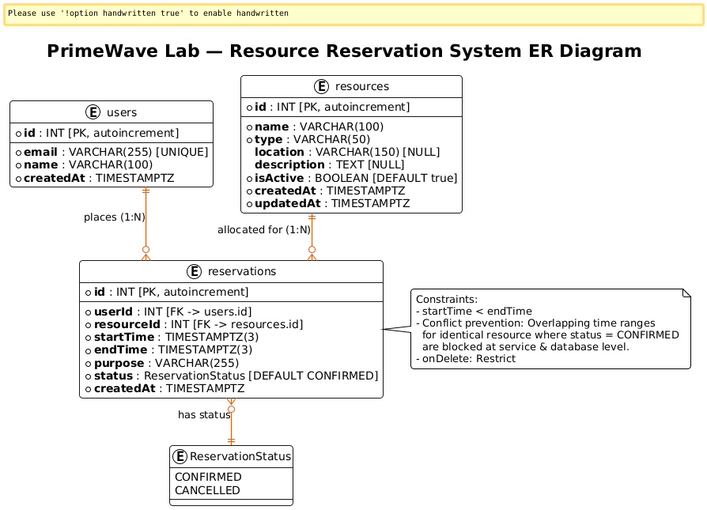
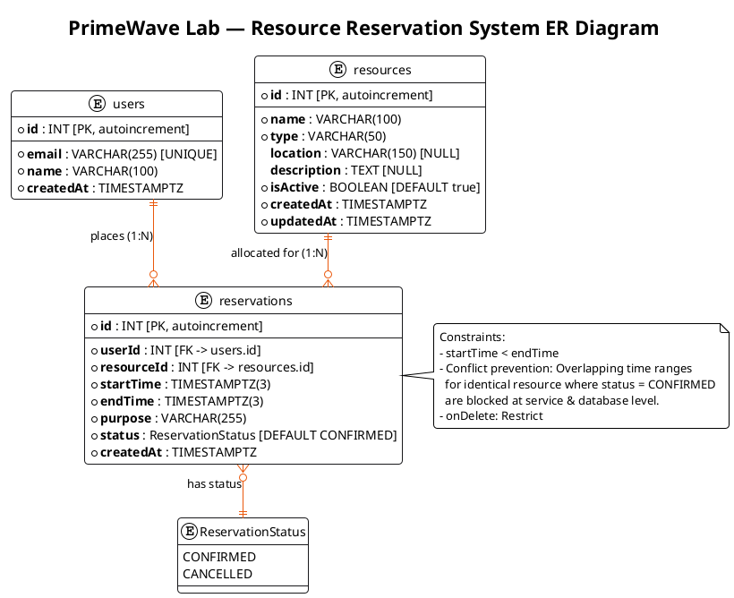
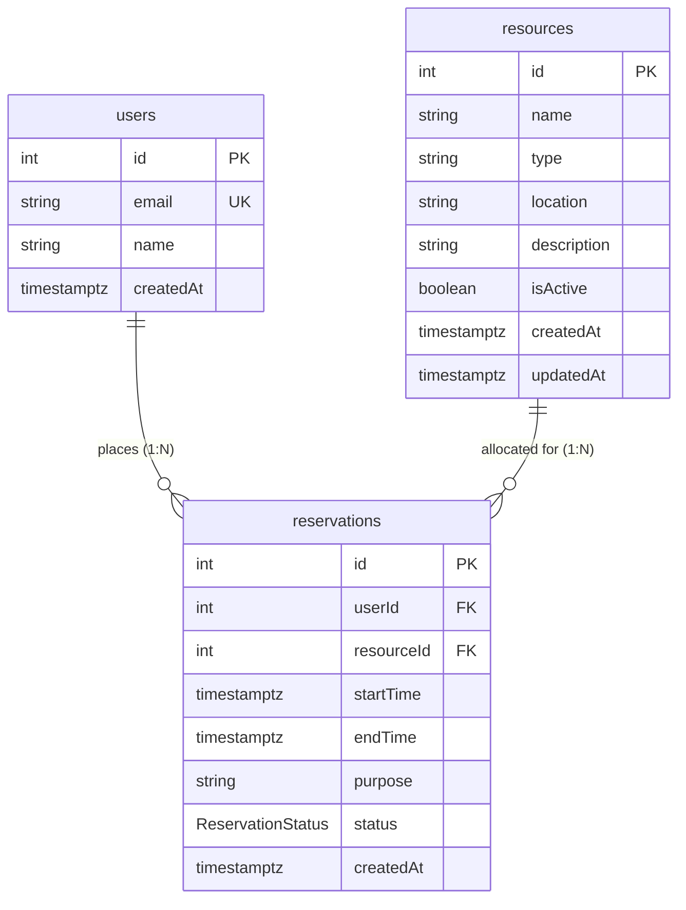

# PrimeWave Lab — Resource Reservation Management System

An enterprise-grade, full-stack web application developed for **PrimeWave Lab (Pvt) Ltd** to centralize facility and laboratory equipment scheduling, eliminate double-bookings through mathematical overlap prevention, and provide real-time utilization visibility across departments.

---

## 1. What This Project Is

In high-pace engineering and research environments like **PrimeWave Lab**, shared resources—such as specialized test benches, conference halls, optical tables, meeting pods, and audiovisual gear—are frequently scheduled via ad-hoc chat channels or shared spreadsheets. This results in:
* **Double-Bookings**: Conflicting bookings that disrupt team experiments, client demos, and meetings.
* **Invisible Availability**: Team members cannot easily see which devices or spaces are operational or free.
* **Lack of Historical Traceability**: Hard-deletions eliminate auditing trails for usage patterns and asset tracking.

**PrimeWave Lab Resource Reservation System** solves these challenges with a unified SaaS management portal built on a modern **White, Orange, and Black** design system. It ensures that every booking is verified against real-time database constraints, guarantees zero schedule overlap, and soft-deactivates inventory non-destructively.

### Core System Features:
* **Real-Time Operations Dashboard (`/dashboard`)**: Live summary metrics (Total Resources, Active Inventory, Total Bookings, Confirmed Slots, Cancelled Slots), upcoming confirmed bookings, and recent activity logs.
* **Resource Inventory Management (`/resources`)**: Full equipment and room catalog with real-time multi-criteria filtering (search, category, status), modal creation with length validation, and non-destructive soft deactivation.
* **Conflict-Free Reservation Engine (`/reservations`)**: Enforces chronological checks ($\text{startTime} < \text{endTime}$) and mathematical overlap prevention on confirmed slots, backed by a real PostgreSQL user directory and instant cancellation releasing time slots.

---

## 2. Database Design & ER Diagram

### ER Diagram Visualization

### PlantUML Source Code

The official database architecture is modeled below in PlantUML. You can copy this code directly into [PlantText](https://www.planttext.com/) or the [PlantUML Online Server](https://www.plantuml.com/plantuml/uml/) to render or generate a shareable link:

### Mermaid Diagram

### Entity & Relationship Breakdown

1. **`users` (`User`)**:
   - `id`: Auto-incrementing integer Primary Key (`INT`).
   - `email`: Unique email identifier (`VARCHAR(255)`).
   - `name`: Full name of the team member (`VARCHAR(100)`).
   - `createdAt`: Timestamp with timezone when the user was registered.
   - **Relationship**: 1 User can place $0..N$ Reservations (`1:N`).

2. **`resources` (`Resource`)**:
   - `id`: Auto-incrementing integer Primary Key (`INT`).
   - `name`: Descriptive name of the equipment, room, or workstation (`VARCHAR(100)`).
   - `type`: Classification category (*Conference Room*, *Laboratory Equipment*, etc.) (`VARCHAR(50)`).
   - `location`: Optional physical office, lab, or building identifier (`VARCHAR(150)`).
   - `description`: Optional equipment specifications or usage notes (`TEXT`).
   - `isActive`: Boolean flag for non-destructive soft deactivation (defaults to `true`).
   - `createdAt` / `updatedAt`: Automatic audit timestamps.
   - **Relationship**: 1 Resource can have $0..N$ Reservations (`1:N`).

3. **`reservations` (`Reservation`)**:
   - `id`: Auto-incrementing integer Primary Key (`INT`).
   - `userId`: Foreign Key referencing `users(id)` (`ON DELETE RESTRICT`).
   - `resourceId`: Foreign Key referencing `resources(id)` (`ON DELETE RESTRICT`).
   - `startTime` / `endTime`: Microsecond-precision timestamps (`TIMESTAMPTZ(3)`).
   - `purpose`: User-provided description or project purpose (`VARCHAR(255)`).
   - `status`: Enum value (`CONFIRMED` or `CANCELLED`).
   - **Indexes & Constraints**:
     - `userId`: B-tree index for efficient user lookup.
     - `(resourceId, startTime, endTime)`: Composite index for high-speed conflict detection queries.
     - **Chronological Rule**: $\text{startTime} < \text{endTime}$.
     - **Overlap Prevention Rule**: Any new reservation on the same resource where $\text{existing.startTime} < \text{requested.endTime}$ and $\text{existing.endTime} > \text{requested.startTime}$ for active `CONFIRMED` bookings is strictly rejected.
